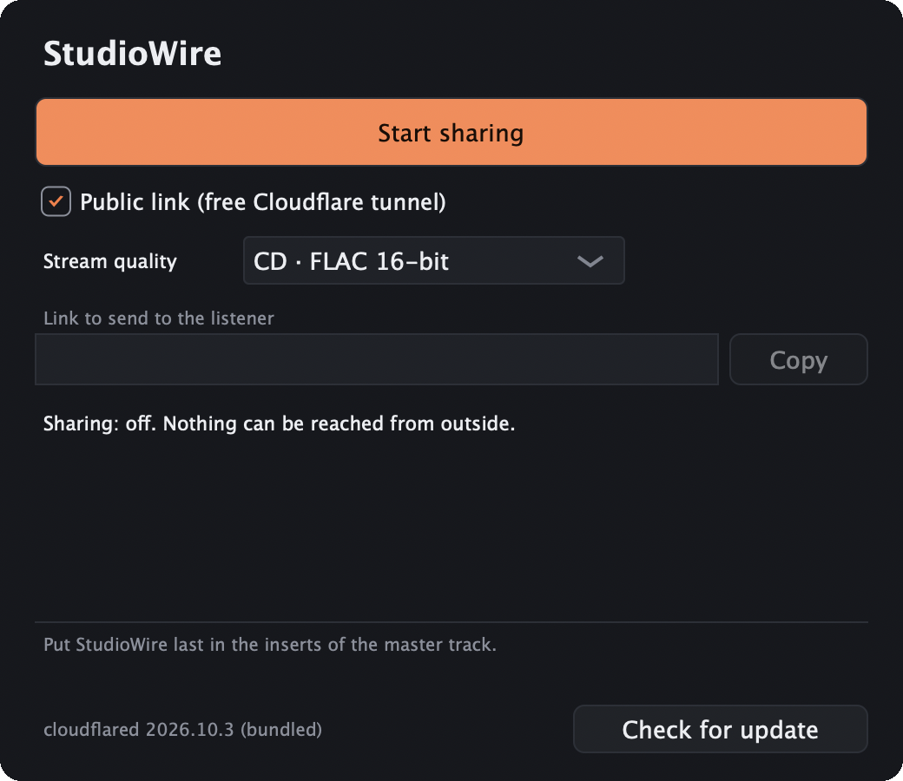
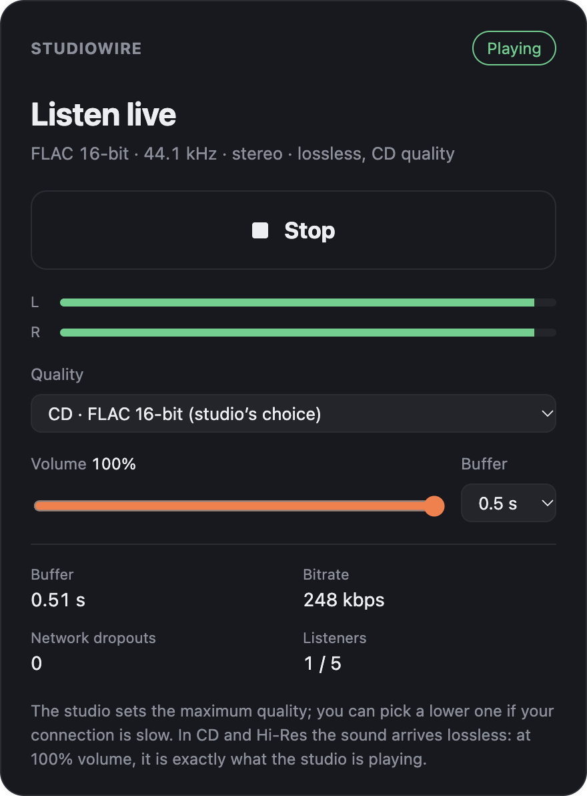

# StudioWire

An AU / VST3 plugin that lets someone listen to your DAW's output in a web
browser (Chrome, Firefox, Safari, phones included), in lossless FLAC or in Opus
for slow connections. Free: there is no server to rent. The plugin serves the
page and the stream itself, and a Cloudflare Quick Tunnel makes it reachable
from the Internet.

```
DAW (master) ─► StudioWire ─► local server 127.0.0.1 ─► cloudflared ─► https://….trycloudflare.com ─► browser
```

<p align="center">
  
  &nbsp;
  
</p>

- macOS 13 Ventura or later, Apple Silicon and Intel. (The plugin itself could
  run on older versions, but the public link needs cloudflared, which is built
  with Go 1.27 and [needs macOS 13](https://go.dev/wiki/MinimumRequirements).
  The installer refuses older versions rather than install something that
  can't share.)
- Any DAW that loads Audio Units or VST3 plugins: Logic Pro and GarageBand use
  the Audio Unit, Cubase the VST3, Ableton Live, Reaper and Studio One either.

## Installing

Get `StudioWire-<version>.pkg` and open it. It installs, for all users:

| What | Where |
|---|---|
| Audio Unit | `/Library/Audio/Plug-Ins/Components/StudioWire.component` |
| VST3 | `/Library/Audio/Plug-Ins/VST3/StudioWire.vst3` |
| Uninstaller | `/Applications/StudioWire/Uninstall StudioWire.app` |
| cloudflared, licences | `/Library/Application Support/StudioWire` |

The installer is not signed with an Apple Developer ID yet, so macOS refuses to
open it the first time:

- macOS 15 and later: open it once, click **Done**, then **System Settings >
  Privacy & Security**, scroll down to the message about StudioWire and click
  **Open Anyway**.
- macOS 13 and 14: right-click (or Control-click) the `.pkg`, choose **Open**,
  then **Open** again.

If your DAW was open, quit and reopen it. If StudioWire doesn't show up, make
your DAW rescan its plugins (in its plugin settings).

To uninstall: **Applications > StudioWire > Uninstall StudioWire**. It asks for
your password and removes the plugins, cloudflared (including updates downloaded
from the plugin) and itself. Your projects are not touched.

StudioWire was previously called MixShare. It keeps the same plugin codes, so
projects that used MixShare open with StudioWire. The installer removes copies
of StudioWire or MixShare from your own `~/Library/Audio/Plug-Ins` folder, so the
DAW doesn't see the plugin twice.

## Using it

1. Insert **StudioWire** last on the master track.
2. Pick the **Stream quality**, then click **Start sharing**.
3. After 5 to 15 seconds the link appears: **Copy** it and send it to the listener.
4. The listener opens the link and clicks **Listen**.

The link changes every time you start sharing and stops working as soon as you
stop sharing or close the project. Listeners who are listening then see
"Sharing has ended". If the connection drops without warning (network, DAW
crash), the page retries, shows "Connection lost" after a few seconds, picks up
again on its own if the studio comes back, and gives up after 2 minutes.

## cloudflared

The installer includes the latest cloudflared at the time it was made. The row
at the bottom of the plugin's window shows which copy is used, and:

- **Check for update** asks GitHub for Cloudflare's latest release;
- **Update to …** downloads it, checks it against the SHA-256 checksum published
  with the release (a file that doesn't match is thrown away), and keeps it in
  `~/Library/Application Support/StudioWire`. It is used from the next
  **Start sharing** on;
- "getting old" appears when the copy in use is more than 6 months old.

StudioWire uses the newest copy it finds among: the updated one, the installed
one, and Homebrew's (`brew install cloudflared`). If none is found, the button
becomes **Download cloudflared**. If none is found, or the one found doesn't run
on this Mac, **Choose…** lets you pick a cloudflared file yourself.

## Sound

**Stream quality** in the plugin sets the maximum quality (CD by default; the
DAW saves it with the project; it can be changed at any time, even while
sharing). Listeners get that quality by default and can only pick a lower one:
with Hi-Res they can choose Hi-Res, CD or Opus; with CD, CD or Opus; with Opus,
Opus only. The limit is enforced by the plugin, not just by the page. If you
lower the quality while people are listening, listeners above it are brought
down to the new maximum (short dropout); if you raise it, those who hadn't
picked anything follow you up. The plugin only encodes the formats that are
actually being heard.

| Quality | Format | Bitrate per listener (rough) |
|---|---|---|
| **CD** (default) | FLAC 16-bit, TPDF dither, project sample rate | ≈ 0.7 to 1 Mbps |
| **Hi-Res** | FLAC 24-bit, project sample rate | ≈ 1.3 to 1.7 Mbps |
| **Opus** | Opus 256 kbps, 48 kHz | ≈ 0.26 Mbps |

- FLAC is lossless: in Hi-Res the listener gets exactly the plugin's 24-bit
  output; in CD, exactly the 16-bit (dithered) version. Checked bit for bit with
  the page's own decoders.
- Silence costs almost nothing in FLAC.
- The player outputs the samples as they are (no resampling or interpolation as
  long as the browser accepts the stream's sample rate).
- About 0.5 s of latency (0.25 to 2 s, set by the listener): made for listening
  to a mix, not for playing together.
- Nothing is sent during an offline bounce.

## Security

- The server only listens on 127.0.0.1: it can only be reached through the tunnel.
- Everything is served under a random 22-character token; anything else returns 404.
- No file from disk is ever served (civetweb is built without a file system).
- 5 listeners at most; nothing starts on its own when a project opens.
- HTTPS encryption ends at Cloudflare.
- cloudflared updates come only from Cloudflare's GitHub releases and must match
  the published SHA-256 checksum.

## Building from source

Needs Apple's Command Line Tools (`xcode-select --install`) and git. CMake is
installed automatically if missing (with Homebrew, or into `.tools/`). The
scripts download JUCE, civetweb, libFLAC, libopus and SpeexDSP at the versions
pinned in `scripts/common.sh`.

**For yourself:** `./build.sh` (or double-click **Build StudioWire.command**)
builds for this Mac's processor, installs the AU and VST3 into
`~/Library/Audio/Plug-Ins`, and runs `auval`. It doesn't install cloudflared:
the plugin offers to download it.

**The installer:** `./package.sh` (or double-click **Make StudioWire
Installer.command**) builds the AU and VST3 for Apple Silicon and Intel
(macOS 13+), downloads cloudflared for both, and writes:

- `build/StudioWire-<version>.pkg`, the installer;
- `build/StudioWire-<version>-source.tar.gz`, the matching source code.

Signing is optional. With an Apple Developer ID:

```
SIGN_APP="Developer ID Application: Name (TEAMID)" \
SIGN_INSTALLER="Developer ID Installer: Name (TEAMID)" \
NOTARY_PROFILE=<notarytool keychain profile> ./package.sh
```

(This path hasn't been tried yet.)

### Code

- `Source/StreamServer.*`: HTTP/WebSocket server (civetweb), no JUCE.
- `Source/Encoders.*`: FLAC (libFLAC) and Opus (libopus + speexdsp) encoders.
- `Source/Tunnel.*`: starts cloudflared and picks up the public address.
- `Source/Cloudflared.*`: finds cloudflared, checks for and installs updates.
- `Source/Plugin*`: the JUCE plugin and its window.
- `web/`: the listening page, the AudioWorklet player and the WebAssembly
  decoders (from wasm-audio-decoders), all embedded in the plugin.
- `packaging/`: what `package.sh` puts in the installer, including the
  uninstaller (`packaging/uninstaller/`).
- `tests/`:
  - a test tool without a DAW (`-DSTUDIOWIRE_BUILD_PLUGIN=OFF -DSTUDIOWIRE_BUILD_HARNESS=ON`);
  - HTTP checks (`check_http.mjs`) and bit-exact checks of the three qualities
    with the page's decoders (`check_codecs.mjs`);
  - stream quality save/restore (`state_test.cpp`, `-DSTUDIOWIRE_BUILD_STATE_TEST=ON`);
  - the cloudflared updater against a fake release server (`cloudflared_test.sh`,
    `-DSTUDIOWIRE_BUILD_CLOUDFLARED_TEST=ON`).

## Licence

StudioWire is free software: you can redistribute it and/or modify it under the
terms of the GNU General Public License as published by the Free Software
Foundation, either version 3 of the License, or (at your option) any later
version. It is distributed in the hope that it will be useful, but WITHOUT ANY
WARRANTY; see [LICENSE](LICENSE).

If you give the installer to someone, the GPL asks that they can get the
matching source code too: hand out the `-source.tar.gz` that `package.sh` makes
along with it, or point them to a public copy of this repository.

Third-party software and licences: [THIRD_PARTY_NOTICES.md](THIRD_PARTY_NOTICES.md).
